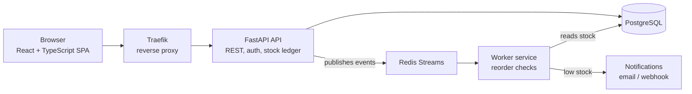

# Binly

**Self-hostable parts inventory for makers, labs, and small shops.** Know what parts you have, where they are, when to reorder, and who changed what.

<!-- Badges: uncomment once CI is running


-->

> **Status: early development.** Binly is being built in public. The features below are the planned v1 scope; checked items are done. A live demo link will appear here once it's deployed.

<!-- Screenshot or GIF goes here once the UI exists -->

## Features

- [ ] **Parts:** SKU, name, category, description, unit, tags, reorder threshold, optional image
- [ ] **Locations:** nested storage, such as `Lab > Shelf B > Bin 12`
- [ ] **Stock ledger:** every change is a recorded movement (receive, consume, adjust, transfer); stock levels are computed from the ledger, so there's a full audit trail
- [ ] **Suppliers and purchase orders:** receiving a PO updates stock automatically
- [ ] **Low-stock alerts:** dashboard list plus email or webhook notifications
- [ ] **Search, filtering, and CSV import/export**
- [ ] **Users and roles:** admin and member, with an audit log of who did what

**Planned after v1:** QR/barcode labels with phone-camera scanning, kits and bills of materials, multi-tenant workspaces.

## Architecture



The API handles requests and writes to Postgres. Anything slow or reactive, such as reorder checks and notifications, is published as an event (`stock.moved`, `po.received`) to Redis Streams and processed asynchronously by a separate worker service.

## Tech stack

| Layer | Technologies |
| --- | --- |
| Frontend | React, TypeScript, Vite, MUI, TanStack Query |
| Backend | Python, FastAPI, SQLAlchemy 2.0, Pydantic v2, Alembic |
| Data | PostgreSQL, Redis Streams |
| Infrastructure | Docker Compose, Traefik, Microsoft Azure |
| Testing | pytest, Testcontainers, Vitest, React Testing Library, Playwright |
| CI/CD | GitHub Actions, GitHub Container Registry |
| Observability | Structured JSON logging, Prometheus, OpenTelemetry, Grafana |

## Quick start

Requires [Docker](https://docs.docker.com/get-docker/) with Docker Compose.

```bash
git clone https://github.com/<your-github-username>/binly.git
cd binly
cp .env.example .env
docker compose up --build
```

Then open http://localhost.

## Project layout

```
binly/
├── frontend/   # React + TypeScript SPA
├── api/        # FastAPI application and Alembic migrations
├── worker/     # Event consumer: reorder checks and notifications
└── infra/      # Docker Compose, Traefik, and deployment config
```

## Development

```bash
# Backend tests (uses Testcontainers, so Docker must be running)
cd api && pytest

# Frontend tests
cd frontend && npm test

# End-to-end tests
cd frontend && npx playwright test
```

## Design notes

- **Why a stock ledger instead of a quantity column?** Every change is an immutable movement record, so stock levels can always be explained and audited, and mistakes are corrected with an adjusting entry instead of an overwrite.
- **Why Redis Streams and a separate worker?** Notifications and reorder checks shouldn't slow down or fail an API request. Events decouple them, and the worker can retry without the user waiting.

More detailed decision records will live in `docs/decisions/`.

## Roadmap

1. Foundation: repo, Docker Compose, CI
2. Core inventory: parts, locations, stock ledger, auth
3. Public demo deployed to Azure with continuous deployment
4. Purchasing and events: suppliers, POs, worker, notifications
5. Ops and quality: end-to-end tests, metrics, tracing, security scanning
6. Polish: docs, screenshots, demo data

## License

[MIT](LICENSE)
